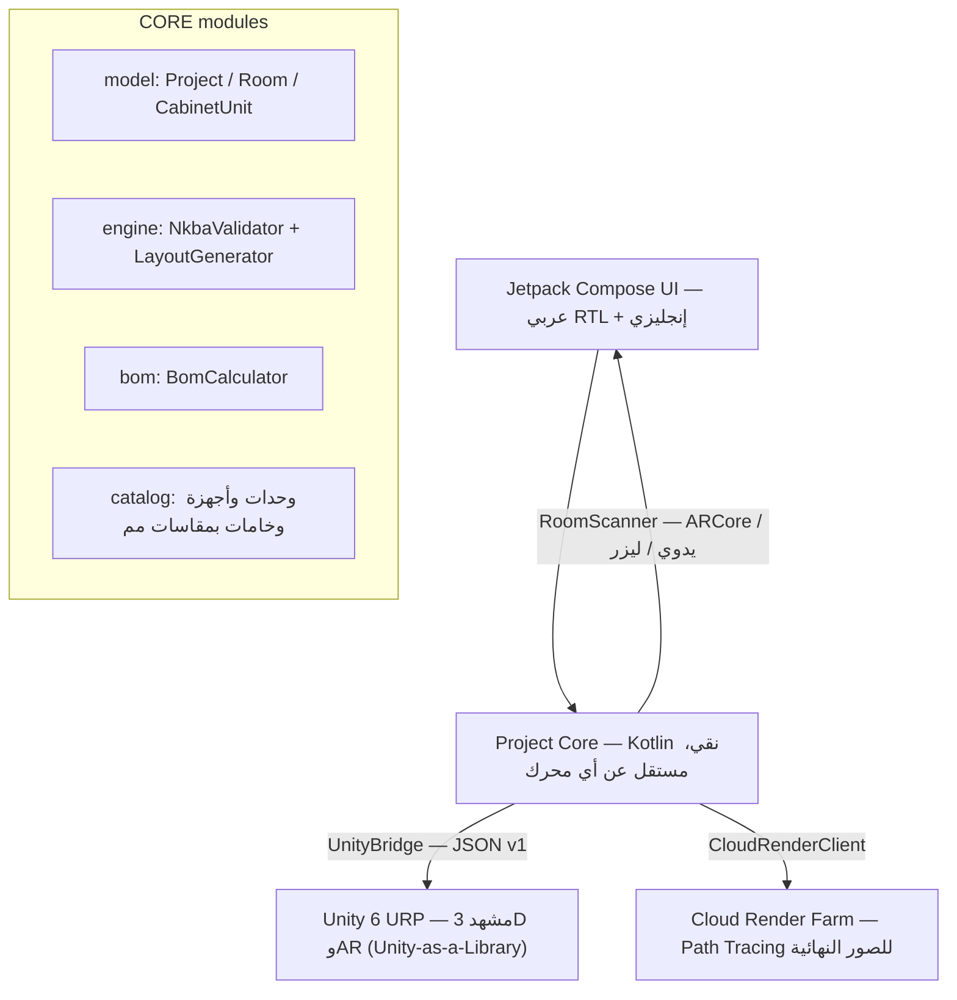

# مصمم المطابخ والمنازل — مشروع Android الأصلي (Kotlin + Unity)

تطبيق Android عالمي لتصميم المطابخ والمنازل: نموذج مطبخ بارامتري (Parametric)، فحص حي
لقواعد NKBA، قائمة مواد وتكلفة فورية، معاينة ثلاثية الأبعاد عبر Unity 6 (URP)، رندر
واقعي نهائي عبر السحابة (Cloud Path Tracing)، ومسح غرف إرشادي بـ ARCore مع إدخال
يدوي/ليزر كمسار للدقة. العربية (RTL كامل) والإنجليزية من اليوم الأول.

هذا هو **مشروع v0.4.0** — المنطق الأساسي مكتوب ومختبَر (162 اختبار Kotlin)، ومشروع
Unity 6 URP مكتوب كمصدر C# كامل، وخادم رندر سحابي تجريبي يعمل فعليًا (Python)،
ومحرّك مواضع 2D باللمس، ومنطق مسح/ليزر، وكتالوج بارامتري موسّع (3,169 SKU).
v0.4.0 أضاف: تحميل الكتالوج فعليًا وقت التشغيل (محلّل JSON نقي + بحث حر ومرشحات،
متحقق منه ضد الملف الحقيقي: 3,169 SKU)، رسم الأبواب (قوس فتح) والنوافذ (خطان)
وأبعاد الجدران المجزأة على مخطط 2D، مساعد تصميم ذكي قائم على قواعد حتمية
(تخطيط + لوحة خامات حسب النمط والميزانية + فحص NKBA + تكلفة، ومجموعات أثاث
لغير المطابخ)، تصدير قائمة مشتريات CSV وتقرير مشروع Markdown للمقاول،
وثلاث لغات جديدة (الفرنسية والإسبانية والتركية — 53 مفتاحًا لكل لغة).
بناء الـAPK محليًا: انظر قسم «طريقة البناء المحلية» وجدول الحالة بالأسفل.

## البنية



المبدأ الحاكم (من البحث): **نموذج المشروع يعيش أطول من أي محرك** — كل الأبعاد بالمليمتر،
والمحرك مجرد عارض/محرر لهذا النموذج.

## خريطة المجلدات

```
kitchen-designer-android/
├── settings.gradle.kts / build.gradle.kts / gradle.properties
├── gradle/wrapper/gradle-wrapper.properties   (ملاحظة: gradle-wrapper.jar غير موجود — انظر بالأسفل)
├── app/
│   ├── build.gradle.kts        (Kotlin 2.0.21, Compose, minSdk 29, target/compileSdk 35)
│   └── src/main/
│       ├── AndroidManifest.xml (supportsRtl=true، ARCore اختياري)
│       ├── res/values/strings.xml + values-ar + values-fr + values-es + values-tr (53 مفتاحًا لكل لغة)
│       └── java/com/kitchendesigner/
│           ├── model/    Project (متعدد الغرف) + ProjectRoom/RoomType، Room, Wall, CabinetUnit, Appliance, WorkTriangle, Opening (أبواب/نوافذ)
│           ├── catalog/  كتالوج بداية + CatalogExpansion (موديل الـ3,169 SKU + تصفية) + CatalogJson (محلّل وقت التشغيل) + CatalogSearch (بحث ومرشحات) + CatalogAssets (محمّل أصول Android)
│           ├── engine/   NkbaValidator + LayoutGenerator (5 تخطيطات) + OpeningValidator (فتحات/تصادم خزائن)
│           ├── editor/   PlacementEngine + EditorState (سحب، Snap، تصادم، Undo/Redo) + WallDimensions (أبعاد مجزأة) + OpeningGeometry (هندسة رسم الفتحات: قوس باب/خطا نافذة)
│           ├── assistant/ DesignAssistant — مساعد تصميم قائم على قواعد (تخطيط/لوحة خامات/NKBA/تكلفة/أثاث)
│           ├── export/   ShoppingListExporter (CSV) + ProjectReportExporter (تقرير Markdown للمقاول)
│           ├── persistence/ ProjectJson — حفظ/تحميل JSON كامل للمشروع (يدوي، بلا مكتبات) + توافق تنسيق v1
│           ├── bom/      BomCalculator + CurrencySpec (USD/SAR/AED/EGP/EUR)
│           ├── unity/    UnityBridge + StubUnityBridge + UnityFacade (Reflection، رجوع للـStub)
│           ├── render/   CloudRenderClient + Stub + HttpCloudRenderClient + RenderPreset + DeviceTier (فئة الجهاز)
│           ├── ar/       RoomScanner + Manual + ScanSession (دمج AR/ليزر وثقة) + LaserDevice + ArCoreRoomScanner
│           └── ui/       MainActivity + EditorScreen (تبويبات غرف + قائمة فتحات) + PlanEditorCanvas + ScanConfirmScreen
│       └── assets/catalog_expansion.json  كتالوج مولّد: 3,169 SKU (انظر scripts/)
├── app/src/test/…  اختبارات JUnit — 162 اختبارًا (محرك، مواضع، مسح، كتالوج، غرف متعددة، فتحات، حفظ/تحميل، أبعاد، بريستات رندر، فئة جهاز، تحليل كتالوج حقيقي، بحث، هندسة فتحات، مساعد تصميم، تصدير)
├── scripts/generate_catalog.py  مولّد الكتالوج البارامتري + تحقق ذاتي
├── server/  خادم رندر تجريبي (Python stdlib): render_server.py + openapi.yaml + Dockerfile + اختبارات
└── unity/KitchenDesignerUnity/  مشروع Unity 6 URP كامل كمصدر (C#) + unity/README.md للإعداد والتصدير
```

## طريقة البناء المحلية / Local build

المتطلبات: **Android Studio** (الأحدث)، **JDK 17**، و**Unity 6** (لقسم الـ3D فقط).

1. افتح مجلد المشروع في Android Studio → انتظر انتهاء Gradle Sync.
   - أول مرة: Android Studio سيولّد `gradle-wrapper.jar` المفقود تلقائيًا، أو شغّل `gradle wrapper` من تثبيت Gradle محلي.
2. لبناء APK تجريبي من سطر الأوامر: `./gradlew :app:assembleDebug`
   ويظهر الناتج في `app/build/outputs/apk/debug/app-debug.apk`.
3. تشغيل التطبيق: Run ▶ على جهاز/محاكي Android (API 29+).
4. اختبارات الوحدة: `./gradlew :app:testDebugUnitTest`

## حالة المشروع — بصراحة

| الجزء | الحالة |
|---|---|
| نموذج المشروع البارامتري + الكتالوج الأساسي | ✅ منطق حقيقي ومختبَر |
| NkbaValidator (مثلث العمل 1.2–2.7م/ضلع، مجموع 3.96–7.93م، ممر عمل 107/122سم، ممر مرور 91.5سم) | ✅ حقيقي ومختبَر |
| LayoutGenerator — 5 تخطيطات بوحدات 60سم | ✅ حقيقي ومختبَر |
| BomCalculator + تحويل عملات | ✅ حقيقي ومختبَر (الأسعار تقديرية ESTIMATE، ليست عروض مورّدين) |
| PlacementEngine + EditorState — سحب وحدات، Snap ‏(10/50مم)، Snap للجدران، كشف تصادم وحدود، تدوير، Undo/Redo | ✅ منطق نقي حقيقي ومختبَر (23 اختبارًا) |
| PlanEditorCanvas (Compose Canvas + سحب باللمس) | ⚠️ مكتوب بعناية ضد واجهات المحرك — لم يُجمَّع بـGradle (لا Android SDK) |
| ScanSession — دمج ملاحظات AR + قياسات ليزر (الليزر يلغي تقدير AR)، أعلام ثقة <0.85 للتأكيد | ✅ منطق نقي حقيقي ومختبَر (14 اختبارًا) |
| ArCoreRoomScanner / LaserDevice (BLE) | ⚠️ هيكل + طبقات TODO-ARCORE / TODO-BLE موثّقة بأسماء الـAPIs الحقيقية وخطوات GATT — لا تشغيل ARCore/BLE فعلي بعد، وUUIDs الليزر Placeholders غير موثّقة من المصنّعين |
| ScanConfirmScreen (Compose: أبعاد قابلة للتحرير + ثقة لكل بُعد) | ⚠️ مكتوب بعناية — لم يُجمَّع بـGradle |
| مشاريع متعددة الغرف (ProjectRoom + RoomType: مطبخ/حمام/معيشة/نوم/مكتب/أخرى) | ✅ منطق حقيقي ومختبَر — التوافق الخلفي بنيوي: البنّاء القديم باقٍ كـSecondary Constructor و`project.room`/`units` عرضان على الغرفة النشطة (6 اختبارات) |
| الأبواب والنوافذ (Opening على جدار: إزاحة/عرض/اتجاه فتح/عتبة) + OpeningValidator | ✅ حقيقي ومختبَر (10 اختبارات): ملاءمة داخل الجدار، عدم تداخل على نفس الجدار، تحذير تصادم مسار خزائن مع منطقة باب يفتح للداخل أو نافذة منخفضة — والنافذة العالية فوق سطح العمل لا تُحذَّر خطأً |
| حفظ/تحميل المشروع (ProjectJson، تنسيق v2 + تحميل v1 القديم) | ✅ حقيقي ومختبَر (6 اختبارات Round-trip لمشروع بغرفتين ووحدات وفتحات وخامات) — JSON يدوي بلا مكتبات خارجية |
| أبعاد الجدران (WallDimensions) | ✅ حقيقي ومختبَر (6 اختبارات): بُعد كلي + مقاطع مجزأة بمواضع الفتحات |
| بريستات الرندر السحابي (RenderPreset: ‏PREVIEW ‏1280/‏STANDARD ‏1920/‏ULTRA ‏3840 + تخصيص) | ✅ عقد Kotlin↔Python واحد ومختبَر من الطرفين: قيم غير صالحة تُرفض بـHTTP 400، والبريست منعكس في بيانات الوظيفة — الرندر نفسه ما زال مُحاكى (`engine: SIMULATED`) |
| فئة الجهاز للمعاينة (DeviceTierClassifier: RAM/GPU/API ← LOW/MEDIUM/HIGH) | ✅ منطق نقي مختبَر (15 اختبارًا): حدود RAM (أقل من 2048MB ← LOW قسريًا)، تخمينات GPU (Adreno/Mali/PowerVR…)، وإعدادات معاينة (دقة خامات/ظلال/FPS) لكل فئة |
| خادم الرندر السحابي `server/` (Queue + Worker، API ‏/v1/renders) | ✅ **يعمل فعليًا ومختبَر** (24 اختبار Python + Smoke Test حي ببريست ULTRA ‏3840) — لكن «Path Tracing» مُحاكى: التقدّم تجريبي والصورة الناتجة PNG Placeholder |
| HttpCloudRenderClient (نفس الـAPI، بلا مكتبات إضافية) | ✅ يُجمَّع بـkotlinc — لم يُشغَّل حيًا ضد الخادم من JVM بعد (الأشكال السلكية مطابقة لاختبارات الخادم) |
| مشروع Unity 6 URP ‏`unity/KitchenDesignerUnity/` | ⚠️ مصدر C# كامل (Bridge/SceneBuilder/Materials/Lighting/Camera + سكربتات Editor للإعداد والتصدير) — **لم يُجمَّع** (لا Unity هنا)، ولا يوجد Main.unity قبل تشغيل قائمة SceneSetup داخل Unity |
| خامات Unity ‏PBR ‏(MaterialLibrary) + إضاءة/ما بعد المعالجة | ⚠️ مصدر C# موسّع في v0.3.0: معاملات PBR كاملة (لون/خشونة/معدنية/Normal/Tiling بوحدات عالمية) للخامات التسع + ستيل مصقول ورخام بعروق وبلوط وجوز وسيراميك مطفي وجرانيت، وبريستات جودة Preview/Realistic/Cinematic (ظلال/AO/تعريض) وPostProcessingSettings (Bloom/Vignette/Tonemapping) وحواف أسطح عمل (Square/Bullnose/Bevel كتقريب هندسي) — **غير مجمّعة**، ومعاملات الخرائط/العروق بيانات مؤلفة تنتظر خرائط خامات فعلية، وربط ما بعد المعالجة بـURP Volume متروك لإعداد المشهد |
| UnityFacade (Kotlin) | ✅ يُجمَّع ومُختبَر سلوكيًا: بلا مكتبة Unity يرجع تلقائيًا لـStubUnityBridge، ومعها يرسل UnitySendMessage عبر Reflection |
| الكتالوج الموسّع `catalog_expansion.json` | ✅ مولّد بسكربت ومتحقق منه: **3,169 SKU** (خزائن 2,316 + أثاث 412 + أرضيات 132 + تشطيبات جدران 120 + تجهيزات حمام 114 + أجهزة 57 + أسطح 18؛ حسب الغرفة: مطبخ 1,737، نوم 534، حمام 486، معيشة 240، مكتب 160، عام 12؛ MENA ‏1,647 / GLOBAL ‏1,522) مع تصفية Kotlin حسب نوع الغرفة/المجموعة — الأسعار ESTIMATE بصيغة حسابية و`supplier: null`، والعناصر إدخالات بارامترية بأبعاد وليست نماذج 3D |
| تحميل الكتالوج وقت التشغيل (CatalogJson + CatalogAssets) | ✅ **حقيقي ومختبَر ضد الملف الفعلي** (v0.4.0): محلّل JSON نقي بلا مكتبات يحلّل الـ3,169 SKU كلها (عدّ الأنواع والمناطق والغرف ونقاط فحص SKU محددة — 6 اختبارات ملف حقيقي)، ومحمّل أصول Android (`context.assets`) مكتوب ضد الـAPI القياسي — لم يُجمَّع بـGradle هنا كونه ملف Android الوحيد في الحزمة |
| بحث الكتالوج (CatalogSearch) | ✅ حقيقي ومختبَر: نص حر (SKU/نوع/خامة/نوع فرعي) + مرشحات نوع غرفة/مجموعة/نوع/سقف سعر/MENA فقط/مقاومة حرارة/رطوبة، ونتائج مرتبة بـSKU — ملحوظة: البحث النصي بالمطابقة الجزئية، فـ"sofa" يجد SOFA ‏(24) وSOFACORNER ‏(18) معًا |
| رسم الفتحات والأبعاد على المخطط (OpeningGeometry + PlanEditorCanvas) | ✅ هندسة الرسم نقية ومختبَرة (9 اختبارات: خط الجدار، قوس فتح الباب للأربع جدران وداخل/خارج، خطا النافذة، نقاط القوس)؛ والـCanvas في Compose صار يرسم الأبواب (فجوة + ضلفة مفتوحة + قوس) والنوافذ (خطان متوازيان) وتسميات الأبعاد المجزأة — كود Compose مكتوب بعناية ولم يُجمَّع بـGradle هنا |
| مساعد التصميم الذكي (DesignAssistant) | ✅ حقيقي ومختبَر (10 اختبارات) — **قواعد حتمية موثّقة، ليس تعلّمًا آليًا**: قواعد حجم/شكل لاختيار التخطيط (صغير ← جدار واحد بلا جزيرة، كبير ← جزيرة)، لوحات خامات لخمسة أنماط (حديث/كلاسيك/إسكندنافي/شرقي MENA/صناعي) تتغير مع فئة الميزانية، مشروع مولّد + فحص NKBA + تقدير BOM للمطابخ، ومجموعات أثاث من الكتالوج لغير المطابخ، مع أكواد قواعد شارحة في النتيجة |
| التصدير (ShoppingListExporter + ProjectReportExporter) | ✅ حقيقي ومختبَر (5 اختبارات بخطوط وإجماليات دقيقة): قائمة مشتريات CSV (عنصر/كمية/وحدة/سعر/إجمالي/عملة مع تحويل عملات الـBOM) وتقرير مشروع Markdown (غرف/أبعاد/فتحات/نتائج NKBA/تقدير لكل غرفة وإجمالي) جاهز للمشاركة مع مقاول |
| اللغات العالمية (values + ‏values-ar/fr/es/tr) | ✅ خمس لغات: عربي وإنجليزي وفرنسي وإسباني وتركي — **53 مفتاحًا لكل لغة**، مجموعات مفاتيح متطابقة مع الإنجليزية تمامًا وXML سليم (متحقق منه بمحلّل XML في Python) |
| APK | ✅ **بُني APK بنجاح (2026-11-22)** — `app/build/outputs/apk/debug/app-debug.apk` ‏(25.6MB، ‏com.kitchendesigner، ‏versionName 0.2.0/versionCode 2، ‏minSdk 29/targetSdk 35، ‏SHA-256 cd9a63df189fa2c7653705f5e7cd052c523a86e85da4a280fd6097f91be2ea03). اكتمل `:app:assembleDebug` محليًا بعد حل سلسلة معوقات بيئة العمل (تشغيل Gradle داخل العملية نفسها بدل Daemon منفصل، بروكسي محلي مرحّل، إضافة شهادة CA الخاصة بالبروكسي إلى Java، تحويل Maven Central إلى مرآة repo1.maven.org محليًا، ترخيص Build-Tools وتعيين buildToolsVersion 35.0.0) وإصلاح خطأين حقيقيين في الكود (موضع uses-feature في الـManifest، واستدعاء footprint في PlanEditorCanvas). ملاحظة: مهمة `:app:testDebugUnitTest` عبر Gradle لم تكتمل في هذه البيئة تحديدًا (مهلة اتصال عملية اختبار فرعية عبر loopback) — والاختبارات نفسها ناجحة 162/162 عبر التحويل المباشر بـkotlinc. مهمل: النص القديم كان يقول ❌ — جرت محاولة بناء محلية كاملة (2026-11-22): ثُبّت Android SDK (platform android-35 + build-tools 35.0.0 + platform-tools) في `~/workspace/android-sdk` وGradle 8.9 في `~/workspace/tools`، واكتمل الـGradle Wrapper في المشروع (`gradlew` + `gradle-wrapper.jar`)، وشُخّصت وحُلّت مشكلة اتصال الـDaemon (إجبار IPv4 بـ`-Djava.net.preferIPv4Stack=true` في `gradle.properties` — ثبت نجاحها ببناء مشروع فارغ)، لكن تنزيل اعتمادات Gradle (AGP/AndroidX/Kotlin) عبر وكيل الخروج **مرفوض من سياسة شبكة بيئة العمل**: الوكيل يرد على أنفاق Gradle برسالة «Other TCP connections is turned off for this assistant» (إعداد Muse: ‏Permissions → Direct network protocols → other_tcp = Deny) ثم يقطع الاتصال، فيفشل حلّ الإضافة `com.android.application:8.5.2` قبل أي تجميع. البناء يكتمل فور تفعيل ذلك الإذن أو على أي جهاز عادي — انظر «طريقة البناء المحلية» |

### التحقق الذي تم فعلًا (2026-11-22، v0.4.0)
- **Kotlin: ‏162 اختبارًا، 162 ناجحًا، 0 فاشلًا** — نفس طريقة التشغيل المستقل
  (kotlinc ‏2.0.21 على JDK 17 + JUnit Platform Console): الـ120 اختبارًا السابقة
  كلها ناجحة دون تعديل أي ملف اختبار قديم، و42 اختبارًا جديدًا:
  تحليل كتالوج (6) + ملف كتالوج حقيقي (6) + بحث كتالوج (6) + هندسة فتحات (9)
  + مساعد تصميم (10) + تصدير (5). اختبار الملف الحقيقي يقرأ
  `catalog_expansion.json` نفسه من القرص ويؤكد: 3,169 SKU فريدة، عدّ الأنواع
  السبعة والمنطقتين والغرف الست مطابق لأرقام المولّد، ونقاط فحص لأسعار/أعلام
  SKU محددة (مثل WT-GRANITE-T20 وAPP-DISHWASHER-450-BLACK).
  ملحوظة صدق: أول تشغيل فشل فيه اختبار واحد بسبب افتراض خاطئ في الاختبار نفسه
  (ظنّ أن بحث "sofa" يعيد SOFA فقط، بينما المطابقة الجزئية الصحيحة تعيد
  SOFACORNER أيضًا) — صُحّح الاختبار وأعيد التشغيل أخضر بالكامل.
- **Python:** اختبارات خادم الرندر أعيد تشغيلها: **24/24 ناجحة**. واللغات
  الثلاث الجديدة تحقّق منها سكربت Python بمحلّل XML: ‏values-fr وvalues-es
  وvalues-tr كلٌّ منها 53 مفتاحًا، مجموعاتها مطابقة للإنجليزية وبلا تكرار.
- ملفات Android/Compose (ومنها CatalogAssets ورسم الفتحات في الـCanvas)
  وC# الخاصة بـUnity لم تُجمَّع هنا — صحتها تركيبية بعناية وغير مُتحقق منها
  ببناء Gradle بعد (انظر محاولة البناء المحلي في جدول الحالة).

### التحقق الذي تم فعلًا (2026-11-22، v0.3.0)
- **Kotlin:** جُمعت كل المصادر النقية (model/catalog/engine/editor/bom/unity/render/ar/persistence)
  مع الاختبارات بـ `kotlinc` ‏(JDK 17) وشُغّلت بـ JUnit Platform Console (مع kotlin-stdlib
  في مسار التشغيل): **120 اختبارًا، 120 ناجحًا، 0 فاشلًا** (57 من v0.2.0 كلها ما زالت
  ناجحة دون تعديل + 28 محرر/غرف/فتحات/حفظ/أبعاد + 5 كتالوج منزل كامل + 30 بريستات/فئة جهاز).
  ملحوظة: اختبارات المشروع بأسلوب JUnit 4 (‏`org.junit.Test`) مطابقة لاعتمادية
  `junit:junit:4.13.2` في Gradle، وتعمل عبر Vintage Engine.
- **Python:** ‏`python3 -m unittest` لخادم الرندر: **24 اختبارًا، الكل ناجح** (10 أصلية
  + 14 بريستات وتحقق). وSmoke Test حي أعيد تشغيله بعد الدمج: ‏POST ببريست ULTRA
  ‏(3840×2160، ‏1024 spp، بلا Denoiser) ← SUCCEEDED ‏100% وبيانات `renderPreset`
  كاملة مع `engine: SIMULATED`، وإرسال عرض 2560 غير الصالح ← HTTP 400 برسالة واضحة.
- **الكتالوج:** سكربت التوليد يعيد التحقق ذاتيًا بعد الكتابة، وأعيد عدّ الملف المولّد
  مستقلًا: **3,169 SKU** بمعرّفات فريدة و`supplier: null` على الكل، والمخطط سليم.
- ملفات Android/Compose وC# الخاصة بـUnity لم تُجمَّع هنا (تحتاج Android SDK / Unity) —
  صحتها تركيبية بعناية لكنها غير مُتحقق منها ببناء فعلي.

## الخطوات التالية
1. فتح المشروع في Android Studio (SDK) لبناء أول APK وتجميع طبقة Compose فعليًا.
2. فتح `unity/KitchenDesignerUnity` في Unity 6، تشغيل SceneSetup، تجميع الـC#، ربط PostProcessingSettings بـURP Volume، وتوفير خرائط خامات (Normal/Pattern) لمعاملات PBR المؤلفة، ثم تصدير unityLibrary وربطه بالتطبيق.
3. استبدال محاكاة الخادم بمحرّك Path Tracing فعلي (GPU) خلف نفس الـAPI والبريستات.
4. تنفيذ TODO-ARCORE داخل ArCoreRoomScanner وTODO-BLE لأجهزة ليزر حقيقية (بعد توثيق UUIDs من المصنّعين).
5. ربط أسعار/مورّدين MENA حقيقيين بالكتالوج (الأسعار الحالية ESTIMATE و`supplier: null`)، وواجهة مستخدم لبحث الكتالوج ومساعد التصميم والتصدير (المنطق جاهز ومختبَر من v0.4.0).

---

# Kitchen & Home Designer — Native Android Project (Kotlin + Unity) [English]

A global Android app for kitchen & home design: a parametric kitchen model, live NKBA
rules checking, instant bill of materials & cost estimate, Unity 6 (URP) 3D preview,
cloud path-traced final renders, and ARCore guided room scanning with manual/laser
entry as the accuracy path. Arabic (full RTL) + English from day one.

This is **v0.4.0**: the core logic is written and tested (162 Kotlin tests), the
Unity 6 URP project exists as complete C# source, a prototype cloud-render
server actually runs (Python stdlib), a touch placement engine and scan/laser
fusion logic are implemented and tested, and the parametric catalog covers the
whole home with 3,169 generated SKUs. v0.4.0 adds runtime catalog loading
(a dependency-free Kotlin JSON parser + free-text/filter search, verified
against the real generated file), opening + segmented-dimension drawing on
the 2D plan (pure-Kotlin geometry, Compose rendering), a deterministic
rule-based design assistant (layout + style/budget palette + NKBA + BOM for
kitchens, catalog furniture sets for other rooms), CSV shopping-list and
Markdown contractor-report exporters, and French/Spanish/Turkish
localisations (53 string keys per locale, key sets verified identical to
English by an XML parser check).

**Architecture, folder map, build steps and the honest status table are in the Arabic
section above** (same content). Key facts in short:

- Pure-Kotlin core (model, catalog, NKBA validator, 5-layout generator, BOM,
  placement engine with snap/collision/undo-redo, scan-session fusion,
  multi-room model, openings validator + drawing geometry, project JSON
  round-trip, wall dimensions, render presets, device tiers, catalog
  parser/search, design assistant, exporters) — **compiled with kotlinc 2.0.21
  on JDK 17 and verified: 162 JUnit tests, 162 passed, 0 failed**
  (2026-11-22). Render server: **24 Python unittests passed** + a live smoke
  test with the ULTRA 3840 preset (job → SUCCEEDED with full preset metadata;
  an invalid 2560 width → HTTP 400).
- A full local build was **attempted** (2026-11-22): Android SDK (platform
  android-35, build-tools 35.0.0, platform-tools) installed under
  `~/workspace/android-sdk`, Gradle 8.9 under `~/workspace/tools`, the Gradle
  Wrapper completed in-project, and the daemon-connection failure diagnosed
  and fixed (`-Djava.net.preferIPv4Stack=true` in `gradle.properties`;
  verified with a successful empty-project build). The build then stops at
  plugin/dependency resolution: this sandbox's egress proxy rejects Gradle's
  download tunnels with an in-band policy message ("Other TCP connections is
  turned off for this assistant" — Muse setting: Permissions → Direct
  network protocols → other_tcp = Deny) and resets the connections, so
  `com.android.application:8.5.2` cannot be fetched and **no APK was built**.
  With that permission enabled, or on any normal machine, `./gradlew
  :app:assembleDebug` is expected to proceed (see the local-build section).
  Compose and Unity C# sources remain uncompiled here. The render server's
  path tracing is simulated.
- Requirements: Android Studio, JDK 17, Unity 6 (for the 3D module only).
